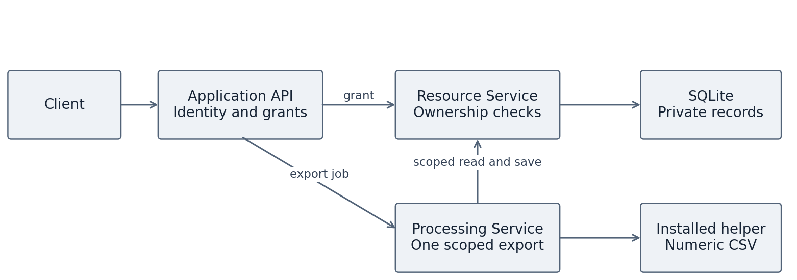

# Private Dataset Workspace

**Student: Moneer · Windows PowerShell · Python 3.12 x64**

A small Python application for storing private datasets and exporting them as CSV. Ali and John are ordinary users; Admin can inspect metadata. The project demonstrates authentication, authorization and security checks across three separately running services.

## 1. Open the project folder

Extract the ZIP and open `secure-workspace`. In File Explorer's address bar, type `powershell` and press Enter. This folder contains `run.py` and this README.

Alternatively, clone the repository:

```powershell
git clone https://github.com/Moneergit/software-security-workspace.git
cd software-security-workspace
```

## 2. Check Python

Install **Python 3.12, 64-bit**, with the Python launcher. Check:

```powershell
py -3.12 --version
```

Expected: `Python 3.12.x`. Git is needed when publishing to GitHub. Docker is not needed.

## 3. Set up once

```powershell
py -3.12 run.py setup
```

This creates `.venv`, downloads and installs the approved Python dependencies, installs the small CSV helper package and seeds the demonstration data. **Internet is needed for the first setup.** You do not need to activate the virtual environment or install packages manually.

## 4. Start the application

```powershell
py -3.12 run.py run
```

This starts all three services. Keep the window open, then open [the API documentation](http://127.0.0.1:8000/docs). Press **Ctrl+C** to stop them.

## 5. Try it

In a second PowerShell window in the same folder:

```powershell
py -3.12 run.py demo
```

The demonstration logs in as Ali, lists Ali's datasets, generates a CSV and retrieves the result. It then tries to read and export John's dataset. Those requests should return **404**, because Ali does not own that data.

## 6. Test it

```powershell
py -3.12 run.py test
```

Expected: **40 passing tests**. The tests start their own temporary services and database. Results are saved in `reports/tests.xml`.

For all build, static analysis, dependency analysis and test checks:

```powershell
py -3.12 run.py check
```

This saves results in `reports/`. Every stage in `reports/gates.json` should have value **0**. Dependency advisory lookup needs internet; a failed check blocks the gate. The supplied evidence in `evidence/final/` was generated on Linux. Jenkins build #2 has also completed successfully on Windows. Keep results from separate environments clearly labelled.

## Jenkins pipeline

The Jenkins pipeline builds the project, runs tests and security checks, and archives the results.

The root `Jenkinsfile` uses a Windows worker labelled `windows-python312` with Git and Python 3.12 available. It checks out a fresh copy, runs `py -3.12 run.py setup`, then `py -3.12 run.py check`. Failed checks fail the build. Jenkins publishes JUnit test results and archives the files in `reports/`.

A Multibranch Pipeline is configured for this repository. GitHub sends push and pull-request events to its Jenkins webhook. Jenkins, its worker and the webhook connection must be running for automatic builds to execute. The local demonstration uses a temporary Cloudflare tunnel; restarting it changes its address, so update the webhook URL. Pipeline logs and reports are viewed in Jenkins, rather than the GitHub Actions tab.

To preserve a local Windows run for submission:

```powershell
New-Item -ItemType Directory -Force evidence\windows | Out-Null
Copy-Item reports\* evidence\windows -Recurse -Force
```

## Application and accounts

| Function          | Behavior                                                |
| ----------------- | ------------------------------------------------------- |
| Login             | Authenticate using a seeded account                     |
| Create and search | Store and list your own datasets                        |
| Read              | Retrieve your own numeric rows                          |
| Export            | Generate and save CSV through all three services        |
| Retrieve result   | Read your own CSV                                       |
| Admin audit       | Inspect owners and titles, without foreign rows/results |

| Username | Password              | Role  |
| -------- | --------------------- | ----- |
| `ali`    | `ali-demo-password`   | User  |
| `john`   | `john-demo-password`  | User  |
| `admin`  | `admin-demo-password` | Admin |

Dataset 1 belongs to Ali; dataset 2 belongs to John. Each dataset has a title and 1–100 integers. These are synthetic local demonstration accounts.

## Architecture



| Component          | Port | Responsibility                       |
| ------------------ | ---- | ------------------------------------ |
| Application API    | 8000 | Login, sessions and coordination     |
| Resource Service   | 8001 | Storage, ownership and authorization |
| Processing Service | 8002 | Generate one authorized CSV export   |

The services run as separate processes and exchange JSON over HTTP. The processing service imports the installed helper package. SQLite is storage, not a fourth application component.

To try an individual request in `/docs`, use `POST /login`, copy the returned token, then enter `Bearer YOUR_TOKEN` in a protected endpoint's `authorization` field. Ali can read `/datasets/1`; `/datasets/2` must return 404.

## Other useful commands

| Command                 | Purpose                                                     |
| ----------------------- | ----------------------------------------------------------- |
| `py -3.12 run.py seed`  | Seed missing demonstration data; preserve existing datasets |
| `py -3.12 run.py build` | Build the separate helper package from source               |
| `py -3.12 run.py smoke` | Start temporary services, demonstrate them and stop         |

Setup installs the approved helper wheel; rebuilding does not automatically approve new bytes. Restarting the server invalidates existing sessions, so log in again.

## What is in the folder

| Location                   | Purpose                                                                      |
| -------------------------- | ---------------------------------------------------------------------------- |
| `workspace_app/`           | The three services and shared schemas/security helpers                       |
| `helper/`                  | The required small CSV package: readable source plus one installable wheel   |
| `scripts/`                 | Service launcher, seeding and build/security checks                          |
| `tests/`                   | Functional, authorization and artifact checks                                |
| `docs/`                    | Initial lifecycle plan, security design, vulnerability notes and diagrams    |
| `evidence/`                | Vulnerable test observations and final verification results                  |
| `requirements.lock`        | Approved dependency versions and hashes used by setup                        |
| `requirements.txt`         | Readable installed-version inventory used by the dependency gate             |
| `bootstrap.lock`           | The approved installer version used before the main install                  |
| `dependencies.sha256.json` | Approval digest for the local helper package                                 |
| `Jenkinsfile`              | Windows Jenkins pipeline                                                     |
| `.gitattributes`           | Consistent LF line endings for package verification across operating systems |

The one `.whl` in `helper/packages/` is an **installable Python package**, not a source file to edit. Its readable code is in `helper/src/workspace_csv/`. It is included because the assignment requires your helper to be installed as a dependency. Third-party packages are downloaded into `.venv` during setup instead of being bundled in the ZIP. Git metadata and temporary environment files are not application source.

## GitHub and submission

Repository: [Moneergit/software-security-workspace](https://github.com/Moneergit/software-security-workspace).

Keep the existing Git history. The `vulnerable-lab` tag preserves the original weaknesses; `main` contains the fixes. Commit and push later changes normally.

Submit the repository URL and exact commit or release tag, the report, saved test and analysis results, and the separate AI-use declaration according to the assignment instructions. The report and declaration are submitted separately from this repository. Save Jenkins build details and exported artifacts as evidence; a localhost link is only accessible from the computer running Jenkins.

[The security design](docs/security_design.md) contains STRIDE and the access matrix; [the vulnerability notes](docs/vulnerabilities.md) explain the four investigations. Optional supply-chain experiments were excluded.

## Troubleshooting

| Problem                                                    | Action                                                                                       |
| ---------------------------------------------------------- | -------------------------------------------------------------------------------------------- |
| `py` not found                                             | Install Python 3.12 with the launcher; reopen PowerShell                                     |
| `run.py` not found                                         | Open PowerShell inside `secure-workspace`                                                    |
| Port already in use                                        | Stop the previous server with Ctrl+C                                                         |
| Helper source does not match approved wheel after checkout | Keep the root `.gitattributes` file; do not change the approved wheel or bypass verification |
| Setup cannot download a package                            | Check the connection and retry setup; do not disable hash verification                       |
| A gate fails                                               | Read the corresponding log in `reports/`                                                     |

This README follows the setup-and-command-table approach of the [course example](https://github.com/Abhi-Vaish/ISRM_Group-4/blob/main/README.md), adapted to this project.
