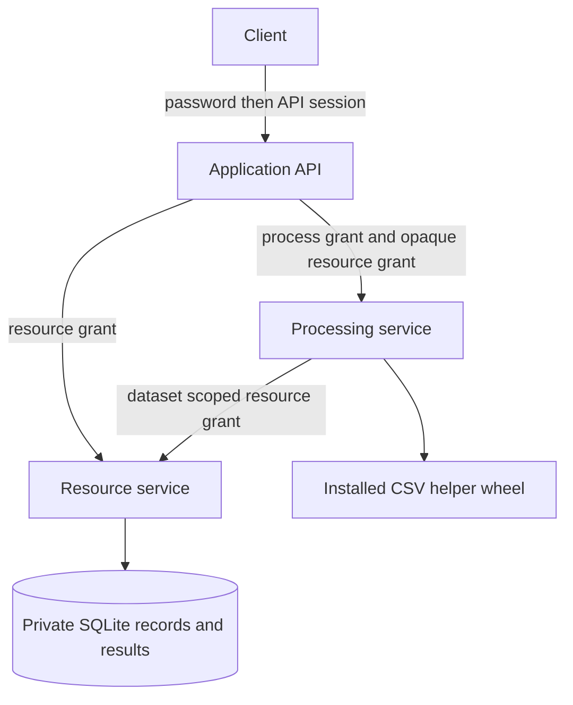
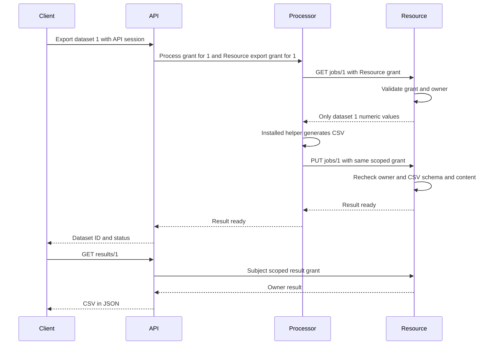

# Architecture and security requirements

## Functional requirements
| ID | Function | Route | Components |
|---|---|---|---|
| FR1 | Login with a seeded account | POST /login | API |
| FR2 | Create and search private datasets | POST/GET /datasets | API, Resource |
| FR3 | Read a private dataset | GET /datasets/{id} | API, Resource |
| FR4 | Export and retrieve numeric CSV | POST /datasets/{id}/export; GET /results/{id} | API, Processor, Resource |
| FR5 | Audit metadata | GET /admin/metadata | API, Resource |

## Nonfunctional requirements
NFR1 reject missing, expired, forged, misaddressed or wrongly scoped credentials. NFR2 require resource ownership at read/export/save, even when a service calls. NFR3 admin privilege grants metadata only. NFR4 cap datasets at 100 integer rows, each between -1000000 and 1000000, title 1–80 characters; forbid unknown fields and coercion. NFR5 parameterized SQL. NFR6 fixed service URLs, five-second timeouts, no redirects/proxy inheritance. NFR7 exact dependency inventory, wheel hashes, required tests and static/advisory gates. NFR8 preserve results and logs as reviewable evidence without credentials or row contents.

## Data model and trust boundaries
Resource SQLite: datasets(id, owner, title, values_json), results(dataset_id, owner, csv). API: salted scrypt password digests in a separate generated account file. Processor: no database/account path or resource signing key in its environment. HTTP JSON crosses every service boundary. Only numeric rows are accepted, so arbitrary CSV formulas cannot be submitted.

Services run separately on loopback. Each API has its own bearer checks. Shared source files are not shared running authority. This prototype does not isolate same-user filesystem access: separate OS identities, read-only mounts and network policy are production requirements. API and Resource share an HMAC key and are mutually trusted for issuance; Processor cannot mint Resource credentials. API/Processor share a different key. A third key signs user sessions. Keys are generated on startup, absent from Git and never printed. Restart invalidates sessions.

## Authority flow
A 15-minute user session has audience api and action session. API validates it, resolves role from its account store, and issues a 60-second Resource grant containing subject, audience, action and exact dataset ID (zero for collection operations). Export adds a separate Processor grant, audience processor, action process, resource dataset ID. Processor relays the Resource grant without owning its signing key. Resource validates signature, issuer, expiry, audience, action, resource ID and database ownership before returning rows and again before saving a result. The grant permits read and save for the one export; it is reusable until expiry, not a one-shot token. No global service credential can read all records.

## Access control matrix
| Operation | Owner user | Other user | Admin on another user's record | Processor |
|---|---|---|---|---|
| Create dataset | Yes under own identity | Own identity only | Own identity only | No |
| List/search datasets | Own metadata | Own metadata only | Own metadata only | No |
| Read dataset rows | Yes | No | No | One export grant only |
| Generate and save CSV | Yes | No | No | One subject/dataset export grant |
| Retrieve CSV result | Yes | No | No | No |
| Global dataset metadata | No | No | Yes | No |

## Asset register
| Asset | Owner or custodian | Property | Primary control |
|---|---|---|---|
| Dataset rows and CSV | Individual user | Confidentiality, integrity | Resource ownership checks |
| Password digest store | API | Confidentiality, identity | Salted scrypt; no plain text persisted |
| Sessions and grants | API and recipient | Authenticity, limited authority | PyJWT, separate keys, expiry and scope |
| Database file | Resource | Integrity, availability | Single owning service; transactions |
| Helper and wheels | Consumer repository | Build integrity | Installed wheel, lock and digest inventory |
| Logs and tests | Repository/CI | Accountability | Metadata logs and archived output |

## STRIDE and SSDLC traceability
| ID | Asset and threat | Requirement and control | Lifecycle activity | Evidence | Gate |
|---|---|---|---|---|---|
| T1 Spoofing | Forged user or service identity | NFR1 JWT validation | Implementation/testing | test_bad_user_token; test_processor_cannot_forge_resource_grant | Any accepted bad token blocks |
| T2 Tampering | Search changes SQL; invalid rows corrupt constraints | NFR4/5 schemas and SQL parameters | Coding/static/testing | test_v1_sql_injection; test_malformed_dataset | Invalid acceptance blocks |
| T3 Repudiation | Cross-user probe cannot be investigated | NFR8 metadata denial logs | Testing/operation | reports/resource.log, source logger | Logs archived; durable audit remains production work |
| T4 Information disclosure | Foreign rows read/exported | NFR2 ownership at every entry | Design/testing | test_v2_cross_user_read; test_v4_confused_deputy_export | Any disclosure blocks |
| T5 Denial of service | Unbounded dataset or stalled downstream | NFR4/6 bounded models and timeout | Implementation/testing | test_v3_row_quota; common.remote | Quota acceptance blocks; network floods remain residual |
| T6 Elevation of privilege | Ordinary user invokes admin action | NFR3 independent role checks | Design/testing | test_admin_metadata; test_direct_resource_owner_and_role | Unexpected admin success blocks |
| T7 Dependency tampering | Unknown or changed wheel | NFR7 artifact verification | Build | test_artifacts.py and check_artifacts.py | Inventory/hash mismatch blocks |

## Secure design principles
| Principle | Decision and implementation | Evidence |
|---|---|---|
| Least privilege | Processor has only its key and receives a dataset-scoped Resource grant; Admin sees metadata only | test_processor_cannot_forge_resource_grant; test_resource_scope; test_admin_metadata |
| Complete mediation | Resource checks direct reads, job reads, job saves and result access independently | test_direct_resource_owner_and_role; job save regression; cross-user tests |
| Fail safe defaults | Missing/invalid identity rejected; unknown fields rejected; service errors stop workflow | test_missing_authentication; test_bad_user_token; malformed input tests |
| Keep it simple | Two entity types, synchronous export, no UI or arbitrary URL input | Route list and small three-service design |

## Scope of guarantees
Synthetic local teaching system only. Admin metadata includes owner and title, so titles must not contain sensitive data. Passwords are public demonstration values; throttling, MFA, TLS, revocation and durable audit are not implemented. The API and Resource are trusted signing authorities. A fully compromised Resource process can read its database; signed grants do not prevent that. Processor code running as the same OS user is not filesystem-sandboxed. Payload schemas limit accepted data, not bytes received before JSON parsing. Resource exhaustion, timing uniformity and concurrent high-load behavior are not claimed as solved.
